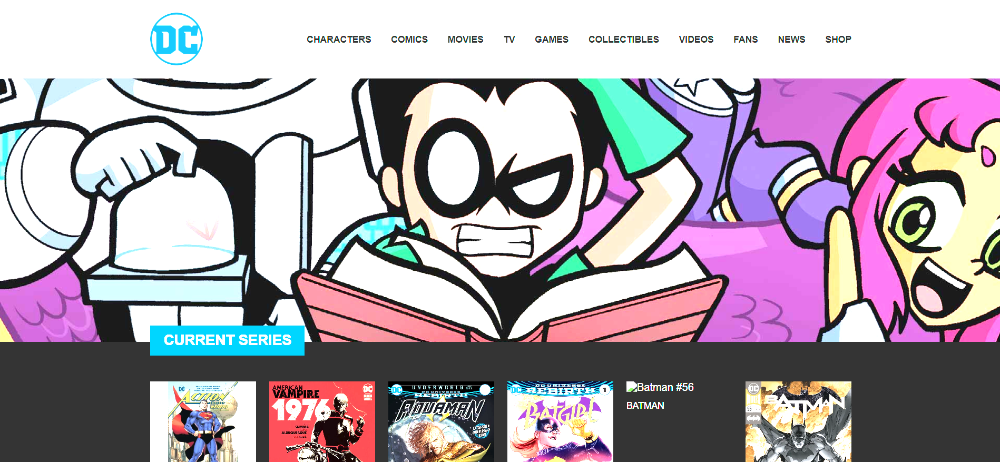

# DC Comics – React

A clone of the DC Comics homepage, built with React and Vite as an exercise for the Boolean Full-Stack Web Developer course.

## Technologies

- React
- Vite
- JavaScript (ES6+)
- CSS3 (Flexbox)

## Project structure

- `src/components/` – one file per component: `AppHeader`, `AppMain`, `AppBuyBar`, `AppFooter`
- `src/data/` – the arrays used to generate the content (comics, navbar links, footer links, icons)
- `public/img/` – static images

## What I learned

- How to create a React project with Vite and run it with `npm run dev`
- How to split a page into components and use `import` / `export default`
- How to write JSX: one parent element, `className`, `{ }` for JavaScript values
- How to generate lists from arrays with `.map()` and why every item needs a `key`
- How to render nested data (footer columns with their own lists of links)

## How to run

    npm install
    npm run dev
